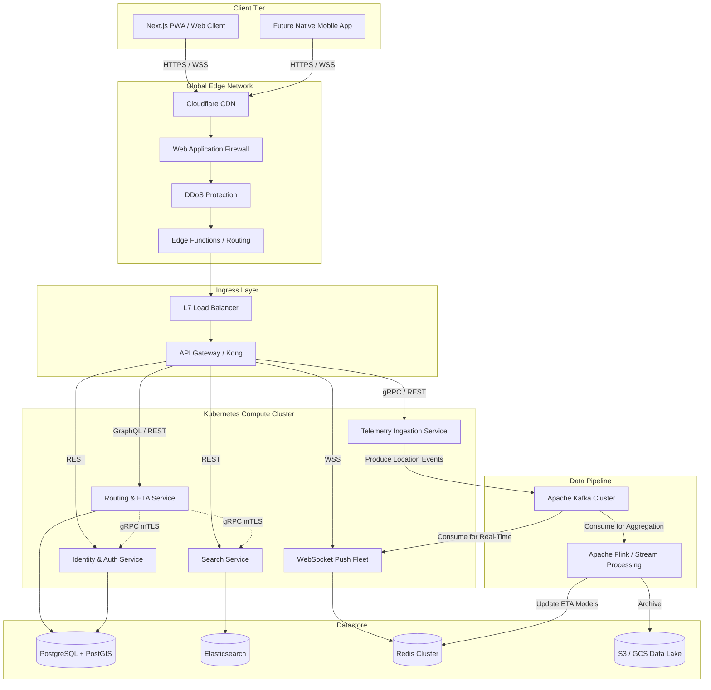

# Enterprise System Architecture: "Where is my Bus" (Kolkata)

## 1. Executive Summary & Design Principles
The "Where is my Bus" platform is designed as a highly distributed, event-driven, microservices-based architecture. Built to handle millions of daily active users and high-throughput telemetry data (crowdsourced GPS pings), the system prioritizes:
- **Ultra-Low Latency**: Sub-100ms real-time location updates from ingestion to the end user.
- **High Availability (99.99%)**: Multi-AZ (Availability Zone) deployments with automatic failover and redundancy.
- **Scalability**: Horizontal auto-scaling for both compute and streaming layers to handle peak Kolkata office commute hours.
- **Domain-Driven Design (DDD)**: Strict boundary separation between core domains (Routing, Telemetry, User Identity).

## 2. High-Level Global Architecture Diagram

## 3. Core Architectural Domains

### A. Edge Network & Security (Cloudflare / AWS Edge)
- **CDN & Asset Delivery**: Next.js static assets and heavily requested static routes are served from edge nodes closest to the user to minimize Time to First Byte (TTFB).
- **WAF & Rate Limiting**: Mitigates malicious attacks (SQLi, XSS) and strictly limits API abuse, which is crucial for preventing bots from scraping proprietary map and route data.

### B. Ingress & API Gateway (Kong / API Six)
- Acts as the single entry point for all client requests.
- **Responsibilities**: SSL termination, JWT (JSON Web Token) validation, API rate limiting, and upgrading persistent HTTP connections to WebSockets for real-time tracking.

### C. Compute Cluster (Kubernetes & Istio Service Mesh)
The compute layer runs on a managed Kubernetes cluster (e.g., AWS EKS or GCP GKE). **Istio** provides a Service Mesh, ensuring secure, encrypted internal communication (mTLS) via ultra-fast **gRPC** protocols.
1. **Telemetry Ingestion Service**: A high-throughput, low-latency service (ideally Golang or Rust) designed exclusively to ingest raw GPS coordinates, drop invalid/noisy points, and publish them to Kafka.
2. **WebSocket Push Fleet**: A horizontally scaling fleet of Node.js instances maintaining stateful WSS connections with clients, subscribing to Redis/Kafka topics, and pushing targeted location updates only to users viewing a specific route.
3. **Routing & ETA Service**: Calculates dynamic ETAs using spatial data and historical traffic models.
4. **Search Service**: Backed by Elasticsearch for lightning-fast, typo-tolerant fuzzy matching of bus stop names, route numbers, and landmarks (e.g., typing "esplaned" instantly returns "Esplanade").

### D. Event Streaming & Real-Time Data Pipeline
- **Apache Kafka**: The central nervous system of the architecture. It completely decouples the ingestion of location data from the consumption, allowing massive spikes in traffic without overwhelming the databases.
- **Apache Flink (Stream Processing)**: Analyzes the Kafka streams in real-time to detect traffic jams, bus delays, or route deviations, subsequently updating the cached ETAs dynamically.

### E. Persistence Layer
- **PostgreSQL + PostGIS**: The absolute source of truth for complex spatial data (e.g., geo-fencing bus routes, calculating geographical distances, storing permanent stops).
- **Elasticsearch**: Optimized specifically for fast text-based search queries and autocompletion.
- **Redis Cluster**: Handles ephemeral, highly volatile data like the absolute current coordinates of an active bus. Provides sub-millisecond read times.
- **Data Lake (S3/GCS)**: Stores raw, anonymized GPS trails for offline Machine Learning (training better predictive ETA models over time).

## 4. Observability & SRE (Site Reliability Engineering)
To maintain enterprise-grade reliability and fast incident response:
- **Metrics**: **Prometheus** scrapes metrics from all pods (CPU, memory, custom business metrics like "GPS pings per second"). Visualized via highly customized **Grafana** dashboards.
- **Distributed Tracing**: **OpenTelemetry** traces requests across the microservices to pinpoint latency bottlenecks instantly.
- **Log Aggregation**: The **ELK Stack** (Elasticsearch, Logstash, Kibana) or Datadog centralizes logs from all services for centralized debugging.

## 5. CI/CD & Deployment Strategy
- **Infrastructure as Code (IaC)**: Terraform manages all cloud resources, ensuring environments are reproducible.
- **Continuous Integration**: GitHub Actions runs unit tests, integration tests, static code analysis, and builds Docker images.
- **Continuous Deployment (GitOps)**: **ArgoCD** continuously monitors the repository and syncs changes to the Kubernetes cluster using a **Blue/Green deployment** strategy. This guarantees zero downtime during updates and allows instant rollbacks if issues are detected.
